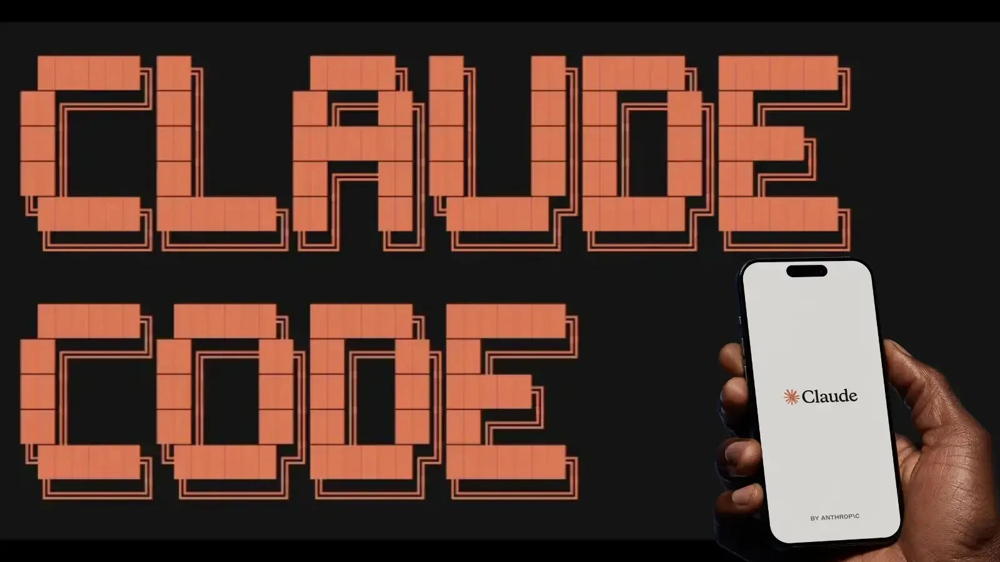

---
tags:
  - ai-generated
---
# How to use remote control

## What it is

Remote control lets you use a Claude Code session on your laptop from your phone or any browser.
You start a task at your desk, and then check on it, answer questions or approve steps from
anywhere.

Claude still runs on your laptop, together with your files, tools and settings. Your phone is only
a window into that session. It shows what happens and sends your messages. Both sides talk through
Anthropic's servers, so your laptop needs no open ports, which anyone on the internet could try to
break in through. This also means your laptop has to stay on, awake and online.

To use it, you need a paid plan: Pro, Max, Team or Enterprise. On Team and Enterprise, an admin
must turn remote control on first. The [official docs](https://code.claude.com/docs/en/remote-control)
cover everything this tutorial leaves out.

## Why use it

You no longer wait at your desk for Claude to finish or to ask for permission. For example:

- Start a long analysis, go to lunch, and approve the next step from your phone.
- Answer Claude's questions while you are in a meeting or on the train.
- Take a photo of a whiteboard sketch and send it. Claude turns it into code or LaTeX on your
  laptop.
- Check on a running job and stop it if something looks wrong.

## Install the app

Scan this code with your phone. It opens the App Store on iOS and Google Play on Android.

No camera at hand? Open [claude.ai/mobile](https://claude.ai/mobile) on your phone.
Sign in with the same claude.ai account you use for Claude Code.

## Turn it on

In the Claude desktop app, open the **Code** tab.

- **For one chat:** type `/rc` in the chat. Type it again to turn it off.
- **For all new chats:** go to **Settings > Claude Code** and turn on
  **Connect new sessions to Remote Control**.

On your phone, open the **Code** tab in the Claude app. Chats with a green dot are online. Open one
and keep typing.

## Keep it running

The desktop app must stay open. If you quit it, your chats go offline on your phone.

Turn on **Keep computer awake while Claude works** in **Settings > Claude Code**. This stops your
laptop from falling asleep during a task. A closed lid still puts it to sleep. When the laptop
wakes up again, your chats reconnect by themselves.

## Pick up an old chat

Old chats are in the sidebar of the desktop app. Click one to continue it. If it had remote control
on before, it shows up on your phone again as the same chat.
